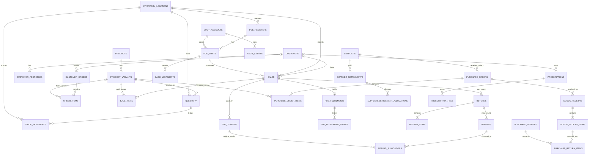

# NMK Opticals POS — Phase 1 Canonical Database Schema Blueprint

**Status:** Logical canonical blueprint for review; not executable DDL and not authorization to change the database.  
**Repository branch:** `master`  
**Companion requirements:** `docs/pos/PHASE-1-DATABASE-DESIGN.md` Sections 10.1–10.28  
**Scope:** One shared MySQL database for the online store, admin dashboard and physical-store POS, with location-scoped inventory and transaction records.

## 1. Purpose and authority

This document converts the reconciled requirements into one canonical table/column dictionary and relationship model. It is the proposed source for a later MySQL-version-specific DDL specification.

Rules:

- Sections 10.25–10.28 of the companion requirements document supersede earlier conceptual baselines where they conflict.
- This blueprint is logical. Exact engine syntax, generated columns, CHECK enforcement, collations, indexes and online migration strategy must be validated against the deployed MySQL version before writing migrations.
- No production database, Java entity, API, SQL migration, credential, deployment setting or existing repository file is changed by this document.
- Existing online orders remain online orders. POS sales are separate. Both channels share variant/location inventory.
- NMK is currently not GST-registered. Do not model GST as collected. Tax-related columns are retained only as extensibility/approved-document snapshots; initial values and invoice wording require accountant/adviser approval.

## 2. Naming, data type and lifecycle conventions

### 2.1 SQL conventions

| Concern | Canonical convention |
|---|---|
| Storage engine | InnoDB |
| Primary key | `BIGINT UNSIGNED AUTO_INCREMENT`, except externally generated public identifiers where separately specified |
| Foreign key | Same integer width/sign as referenced primary key |
| Timestamp | `DATETIME(6)`, stored consistently in UTC; business financial-year calculations use Asia/Kolkata |
| Money | `DECIMAL(12,2)` INR; never FLOAT/DOUBLE |
| Quantity | `INT` for discrete units; positive transaction quantity plus explicit signed deltas in ledger |
| Rates/ratios | `DECIMAL(9,4)` only where a rate is required |
| Boolean | `BOOLEAN NOT NULL` with explicit default where safe |
| Status/type | `VARCHAR(32)` or `VARCHAR(40)`; service validation plus DB constraints where supported |
| Notes/reasons | Bounded `VARCHAR` unless long text is justified |
| Idempotency | `VARCHAR(100)` or `VARCHAR(150)`, scoped and unique per operation/source |
| Soft lifecycle | Explicit status and timestamps; do not physically delete referenced financial/history rows |
| Audit timestamps | `created_at`, `updated_at`; append-only events also have `occurred_at` |

All money values are INR. The database timezone convention must be confirmed and consistently applied in JDBC, MySQL session settings, scheduled jobs and reports.

### 2.2 Common rules

- Use stable internal IDs; never derive primary keys or SKU values from mutable product names, colours or sizes.
- Every posted business transaction has an immutable reference number and idempotency key where a retry could repeat a side effect.
- Snapshot customer/product/variant/pricing/discount/fulfilment details required to reproduce historical documents.
- Do not use cascading deletes from master records into financial, stock, audit, prescription or transaction history.
- Nullable actor IDs are allowed only for legacy backfill or explicitly system-generated events; new privileged actions require a verified staff actor.
- Foreign keys should normally use RESTRICT/NO ACTION for historical and financial references. Child cleanup is not a substitute for retention policy.
- Status values listed below are proposed enumerations; final transitions must be implemented and tested in service logic.

## 3. Canonical table inventory

| Domain | Tables |
|---|---|
| Catalogue | `products` (existing, additive migration), `product_variants` |
| Locations/inventory | `inventory_locations`, `inventory`, `stock_movements`, `stock_counts`, `stock_count_lines`, `stock_adjustments`, `stock_adjustment_lines`, `reorder_rules`, `stock_alerts` |
| Customers/prescriptions | `customers`, `customer_addresses`, `prescriptions`, `prescription_files`, `prescription_access_events` |
| Online channel | `customer_orders` (existing), `order_items` (existing, additive variant mapping), existing payment/webhook records |
| POS channel | `sales`, `sale_items`, `pos_tenders`, `pos_fulfilments`, `pos_fulfilment_events`, `returns`, `return_items`, `refunds`, `refund_allocations` |
| Invoice numbering | `invoice_sequences`, `invoice_issuances` |
| Staff/security | `staff_accounts` (staged migration from existing admins), `roles`, `permissions`, `role_permissions`, `staff_role_assignments`, `staff_sessions`, `action_approvals`, `audit_events` |
| Cash operations | `pos_registers`, `pos_shifts`, `cash_movements`, `electronic_tender_reconciliations` |
| Procurement | `suppliers`, `purchase_orders`, `purchase_order_items`, `goods_receipts`, `goods_receipt_items`, `purchase_returns`, `purchase_return_items`, `supplier_settlements`, `supplier_settlement_allocations` |

The existing online order/payment tables are retained and extended only after compatibility review. Do not create a second online payment ledger in the POS tables.

## 4. Catalogue and variant schema

### 4.1 `products` — existing parent catalogue

Existing product entity/table remains the parent customer-facing listing. It is not the inventory identity.

| Column | Type | Null | Key / rule |
|---|---|---:|---|
| id | BIGINT UNSIGNED | No | PK; preserve existing ID |
| name | VARCHAR(255) | No | Existing product display name |
| description | TEXT | Yes | Existing description |
| brand | VARCHAR(120) | Yes | Existing brand |
| category | VARCHAR(80) | Yes | Existing category |
| default_price | DECIMAL(12,2) | No | Parent default price; backend authoritative |
| lifecycle_status | VARCHAR(24) | No | ACTIVE / INACTIVE / DISCONTINUED / ARCHIVED |
| online_visible | BOOLEAN | No | Default true/false by approved migration |
| pos_available | BOOLEAN | No | Separate POS eligibility |
| legacy_stock_quantity | INT | Yes | Temporary legacy compatibility only; not authoritative after cutover |
| specifications | JSON | Yes | Legacy descriptive attributes during migration; variant-defining values must be mapped |
| created_at | DATETIME(6) | No | Existing or additive |
| updated_at | DATETIME(6) | No | Existing or additive |

Existing column names/types may differ. Migration must map actual `Product` fields rather than rename/drop them blindly. Product lifecycle changes are audited; no direct stock edits after inventory cutover.

### 4.2 `product_variants`

One row per sellable combination (for example, frame colour/size/power configuration). Customer catalogue normally displays the parent product once and lets the customer select a variant.

| Column | Type | Null | Key / rule |
|---|---|---:|---|
| id | BIGINT UNSIGNED | No | PK |
| product_id | BIGINT UNSIGNED | No | FK → products.id |
| sku | VARCHAR(40) | No | Globally unique, permanent NMK-generated SKU |
| barcode_value | VARCHAR(100) | Yes | Normalized; unique when non-empty |
| option_values | JSON | No | Canonical selected variant attributes |
| variant_label | VARCHAR(255) | No | Human-readable snapshot/label |
| price_override | DECIMAL(12,2) | Yes | Null means use parent default price |
| lifecycle_status | VARCHAR(24) | No | ACTIVE / INACTIVE / DISCONTINUED / ARCHIVED |
| online_available | BOOLEAN | No | Independent channel eligibility |
| pos_available | BOOLEAN | No | Independent channel eligibility |
| is_default | BOOLEAN | No | At most one default per parent, guarded transactionally |
| created_at | DATETIME(6) | No | |
| updated_at | DATETIME(6) | No | |

**Constraints/indexes:** FK product; UNIQUE(sku); unique normalized non-empty barcode using a MySQL-version-compatible approach; INDEX(product_id, lifecycle_status); one default variant per parent enforced with reviewed generated-key or parent-row lock strategy. Effective price = variant override if present, otherwise parent default. Backend validates active status, channel eligibility, price and stock.

## 5. Location and authoritative inventory schema

### 5.1 `inventory_locations`

| Column | Type | Null | Key / rule |
|---|---|---:|---|
| id | BIGINT UNSIGNED | No | PK |
| code | VARCHAR(30) | No | UNIQUE |
| name | VARCHAR(120) | No | |
| location_type | VARCHAR(24) | No | STORE / WAREHOUSE |
| address_snapshot | JSON | Yes | Operational address |
| active | BOOLEAN | No | |
| created_at | DATETIME(6) | No | |
| updated_at | DATETIME(6) | No | |

First release may expose one active shop location, but schema is location-scoped.

### 5.2 `inventory`

Exactly one authoritative summary row per (location, variant).

| Column | Type | Null | Key / rule |
|---|---|---:|---|
| id | BIGINT UNSIGNED | No | PK |
| location_id | BIGINT UNSIGNED | No | FK → inventory_locations.id |
| variant_id | BIGINT UNSIGNED | No | FK → product_variants.id |
| on_hand_quantity | INT | No | Physical sellable units, including online-reserved units |
| reserved_quantity | INT | No | Subset held for online pending payment |
| updated_at | DATETIME(6) | No | |

**Constraints:** UNIQUE(location_id, variant_id); on_hand_quantity >= 0; reserved_quantity >= 0; reserved_quantity <= on_hand_quantity. `available_quantity = on_hand_quantity - reserved_quantity` is derived and is never independently stored as a second source of truth.

### 5.3 `stock_movements`

Append-only inventory ledger. Each movement is scoped to one location and variant.

| Column | Type | Null | Key / rule |
|---|---|---:|---|
| id | BIGINT UNSIGNED | No | PK |
| location_id | BIGINT UNSIGNED | No | FK → inventory_locations.id |
| variant_id | BIGINT UNSIGNED | No | FK → product_variants.id |
| movement_type | VARCHAR(40) | No | Controlled event type |
| quantity_delta | INT | No | Signed on-hand change |
| reserved_delta | INT | No | Signed reservation change |
| on_hand_after | INT | No | Resulting summary snapshot |
| reserved_after | INT | No | Resulting summary snapshot |
| reference_type | VARCHAR(40) | No | Source domain |
| reference_id | BIGINT UNSIGNED | No | Source row identifier |
| idempotency_key | VARCHAR(150) | No | Unique per movement operation |
| reason | VARCHAR(500) | Yes | Required for manual/exception events |
| actor_staff_id | BIGINT UNSIGNED | Yes | FK → staff_accounts.id; nullable only for documented system/legacy events |
| created_at | DATETIME(6) | No | |

Indexes: (location_id, variant_id, created_at), (reference_type, reference_id), UNIQUE(idempotency_key). The application transaction locks the inventory row, updates summary and inserts ledger row atomically. Ledger corrections are compensating rows, never edits/deletes.

Canonical movements:

| Event | quantity_delta | reserved_delta |
|---|---:|---:|
| Online reservation created | 0 | +Q |
| Online reservation safely released | 0 | -Q |
| Online payment confirmed against reservation | -Q | -Q |
| POS sale completed | -Q | 0 |
| Approved return restock | +Q | 0 |
| Accepted goods receipt | +Q | 0 |
| Purchase return physically dispatched | -Q | 0 |
| Damage/write-off | -Q | 0 |

### 5.4 Stock counts and adjustments

**`stock_counts`**

| Column | Type | Null | Key / rule |
|---|---|---:|---|
| id | BIGINT UNSIGNED | No | PK |
| location_id | BIGINT UNSIGNED | No | FK |
| count_number | VARCHAR(40) | No | UNIQUE within location |
| status | VARCHAR(24) | No | DRAFT / COUNTING / SUBMITTED / REVIEWED / POSTED / CANCELLED |
| started_at | DATETIME(6) | No | |
| submitted_at | DATETIME(6) | Yes | |
| reviewed_by_staff_id | BIGINT UNSIGNED | Yes | FK staff |
| posted_at | DATETIME(6) | Yes | |
| created_by_staff_id | BIGINT UNSIGNED | No | FK staff |
| created_at | DATETIME(6) | No | |

**`stock_count_lines`**

| Column | Type | Null | Key / rule |
|---|---|---:|---|
| id | BIGINT UNSIGNED | No | PK |
| stock_count_id | BIGINT UNSIGNED | No | FK |
| variant_id | BIGINT UNSIGNED | No | FK |
| expected_on_hand | INT | No | Snapshot at count/cutoff |
| counted_quantity | INT | Yes | Physical count |
| variance_quantity | INT | Yes | Derived |
| note | VARCHAR(500) | Yes | |
| counted_by_staff_id | BIGINT UNSIGNED | Yes | FK staff |

Unique(stock_count_id, variant_id). Count posting creates approved adjustment movements; a draft/count alone never changes inventory. Intervening movements must be reconciled against the cutoff snapshot.

**`stock_adjustments`** header: id PK; location_id FK; adjustment_number UNIQUE per location; status DRAFT/REQUESTED/APPROVED/POSTED/REJECTED/CANCELLED; reason_code; reason_text; requested_by_staff_id FK; approved_by_staff_id FK nullable; posted_at; created_at.

**`stock_adjustment_lines`**: id PK; adjustment_id FK; variant_id FK; quantity_delta INT nonzero; reason_code; note. Posting is atomic with stock ledger. Cashier cannot independently post adjustments.

### 5.5 Reorder rules and alerts

**`reorder_rules`**: id PK; location_id FK; variant_id FK; minimum_available INT; target_available INT nullable; active BOOLEAN; created_by_staff_id FK; updated_at. UNIQUE(location_id, variant_id). Validate target >= minimum >= 0.

**`stock_alerts`**: id PK; location_id FK; variant_id FK; alert_type LOW_STOCK/OUT_OF_STOCK; observed_available INT; status OPEN/ACKNOWLEDGED/RESOLVED; opened_at; acknowledged_by_staff_id nullable FK; acknowledged_at; resolved_at; evaluation_key/idempotency key. Maintain at most one active alert per variant/location/condition using a MySQL-compatible active-key strategy. Alerts never alter stock. Reorder suggestion = target - available where target exists.

## 6. Customer and prescription schema

### 6.1 `customers`

| Column | Type | Null | Key / rule |
|---|---|---:|---|
| id | BIGINT UNSIGNED | No | PK |
| name | VARCHAR(150) | Yes | |
| phone | VARCHAR(20) | Yes | Display/contact value |
| phone_normalized | VARCHAR(20) | Yes | Indexed; uniqueness not assumed initially |
| email | VARCHAR(254) | Yes | |
| active | BOOLEAN | No | |
| created_at | DATETIME(6) | No | |
| updated_at | DATETIME(6) | No | |

Walk-in sale may have no customer. No automatic profile merge based only on phone; duplicate handling requires explicit review.

### 6.2 `customer_addresses`

id PK; customer_id FK; address_line VARCHAR(1000); city VARCHAR(120); state VARCHAR(120); pincode VARCHAR(20); is_default BOOLEAN; created_at; updated_at. Index(customer_id, is_default). At most one default address per customer, enforced transactionally.

### 6.3 `prescriptions`

| Column | Type | Null | Key / rule |
|---|---|---:|---|
| id | BIGINT UNSIGNED | No | PK |
| customer_id | BIGINT UNSIGNED | Yes | FK → customers.id |
| online_order_item_id | BIGINT UNSIGNED | Yes | FK → existing order_items.id |
| pos_sale_item_id | BIGINT UNSIGNED | Yes | FK → sale_items.id |
| version_number | INT | No | Positive, versioned |
| prescription_type | VARCHAR(30) | No | EYE / CONTACT_LENS / OTHER |
| right_sph | DECIMAL(6,2) | Yes | |
| right_cyl | DECIMAL(6,2) | Yes | |
| right_axis | SMALLINT | Yes | Range validation 0–180 |
| right_add | DECIMAL(6,2) | Yes | |
| left_sph | DECIMAL(6,2) | Yes | |
| left_cyl | DECIMAL(6,2) | Yes | |
| left_axis | SMALLINT | Yes | Range validation 0–180 |
| left_add | DECIMAL(6,2) | Yes | |
| pd_value | DECIMAL(6,2) | Yes | Validate according to supported single/binocular model |
| prescriber_name | VARCHAR(150) | Yes | |
| prescribed_at | DATE | Yes | |
| expires_at | DATE | Yes | |
| notes_private | VARCHAR(1000) | Yes | Restricted access |
| created_by_staff_id | BIGINT UNSIGNED | Yes | FK staff |
| created_at | DATETIME(6) | No | |

Exactly one transaction-item owner is set for a transaction-bound prescription (online item XOR POS item); customer-only reusable history may have neither. Enforce with reviewed DB constraint plus service validation. Preserve the exact version used by each order/sale; later customer edits do not mutate historical snapshots.

### 6.4 `prescription_files` and `prescription_access_events`

**`prescription_files`**: id PK; prescription_id FK; object_key VARCHAR(500) UNIQUE; original_filename VARCHAR(255) nullable; media_type VARCHAR(100); byte_size BIGINT; checksum VARCHAR(128); upload_status PENDING/AVAILABLE/FAILED/DELETED; uploaded_at; created_at. Store private object key/metadata only, never public URL or storage credentials.

**`prescription_access_events`**: id PK; prescription_id FK; file_id FK nullable; staff_id FK nullable; customer_id FK nullable; action VIEW/DOWNLOAD/UPLOAD/UPDATE/DELETE; outcome; occurred_at; request_correlation_id. Index(prescription_id, occurred_at), (staff_id, occurred_at). Do not log prescription values, secrets or object URLs.

## 7. Existing online order integration

### 7.1 Existing tables retained

- `customer_orders` remains the online order and online payment lifecycle.
- `order_items` remains the online order line snapshot.
- Existing Razorpay payment identifiers, webhook event records and verification logic remain in their current domain.
- Existing customer name/phone/email/address fields remain immutable order-time snapshots.

### 7.2 Additive order-item mapping

Add nullable `variant_id BIGINT UNSIGNED` to existing `order_items`, FK to `product_variants.id`, plus an index. Backfill only when legacy specifications map unambiguously. Ambiguous legacy products require manual resolution. Do not switch stock authority until every active reservable order item has a valid variant/location mapping.

Online reservation state may be represented by existing order reservation fields initially, but canonical ledger movement references must be unique to the source order-item/reservation attempt. If a separate `online_stock_reservations` table is later selected, its ownership and state must be explicit; do not maintain duplicate reservation state in multiple places.

Payment success converts reservation to sale using (-Q on-hand, -Q reserved), exactly once. Safe cancellation/expiry releases reserved only. Uncertain Razorpay status retains the reservation. Existing fail-closed scheduler behaviour must be preserved during migration.

## 8. POS sales, tenders, fulfilment, returns and refunds

### 8.1 `sales`

| Column | Type | Null | Key / rule |
|---|---|---:|---|
| id | BIGINT UNSIGNED | No | PK |
| sale_number | VARCHAR(50) | No | UNIQUE internal business reference |
| invoice_issuance_id | BIGINT UNSIGNED | Yes | FK → invoice_issuances.id; required when invoice issued |
| location_id | BIGINT UNSIGNED | No | FK → inventory_locations.id |
| customer_id | BIGINT UNSIGNED | Yes | FK → customers.id |
| register_id | BIGINT UNSIGNED | No | FK → pos_registers.id |
| shift_id | BIGINT UNSIGNED | No | FK → pos_shifts.id |
| status | VARCHAR(24) | No | DRAFT / COMPLETED / VOIDED; immutable after completion except separate events |
| subtotal_amount | DECIMAL(12,2) | No | |
| item_discount_amount | DECIMAL(12,2) | No | Default 0 |
| bill_discount_amount | DECIMAL(12,2) | No | Default 0 |
| tax_amount | DECIMAL(12,2) | No | Initial policy must not represent GST as collected |
| total_amount | DECIMAL(12,2) | No | Backend-calculated |
| customer_name_snapshot | VARCHAR(150) | Yes | |
| customer_phone_snapshot | VARCHAR(20) | Yes | |
| sold_at | DATETIME(6) | Yes | Set on completion |
| completed_by_staff_id | BIGINT UNSIGNED | No | FK staff |
| idempotency_key | VARCHAR(150) | No | UNIQUE |
| created_at | DATETIME(6) | No | |

Completed POS sale requires confirmed tender allocations totaling exactly total_amount. No customer credit/part-paid completed sale in initial release. Split tender is supported.

### 8.2 `sale_items`

id PK; sale_id FK; variant_id FK; product_name_snapshot VARCHAR(255); variant_label_snapshot VARCHAR(255); sku_snapshot VARCHAR(40); barcode_snapshot VARCHAR(100) nullable; quantity INT positive; unit_price DECIMAL(12,2); discount_amount DECIMAL(12,2); tax_amount DECIMAL(12,2); line_total DECIMAL(12,2); prescription_id FK nullable; created_at. Index(sale_id), (variant_id, sale_id). Snapshots are immutable after sale completion.

### 8.3 POS tender records

**`pos_tenders`**: id PK; sale_id FK; shift_id FK; method CASH/UPI/CARD/OTHER; provider VARCHAR(40) nullable; amount DECIMAL(12,2) positive; status INITIATED/CONFIRMED/FAILED/REVERSED; provider_reference VARCHAR(150) nullable; idempotency_key VARCHAR(150) UNIQUE; accepted_by_staff_id FK; confirmed_at nullable; created_at. Index(sale_id, status), (shift_id, method, status). Unique provider reference must be scoped to provider/merchant as approved. Never store card credentials or UPI PIN.

Electronic tender is confirmed only using the approved terminal/provider verification process. A cashier marking “paid” in the UI is not authoritative provider confirmation.

### 8.4 Fulfilment

**`pos_fulfilments`**: id PK; sale_id FK UNIQUE; status PENDING_PREPARATION/READY_FOR_COLLECTION/COLLECTED/CANCELLED; expected_collection_at nullable; ready_at nullable; collected_at nullable; collected_by_staff_id nullable FK; updated_at.

**`pos_fulfilment_events`**: id PK; fulfilment_id FK; from_status nullable; to_status; actor_staff_id FK; note; occurred_at. Append-only. Payment status and fulfilment status are separate. Stock is deducted once when sale completes, never again at ready/collection.

### 8.5 Returns and refund domain

**`returns`**: id PK; return_number VARCHAR(50) UNIQUE; original_sale_id FK; location_id FK; status REQUESTED/APPROVED/REJECTED/RECEIVED/INSPECTED/COMPLETED/CANCELLED; reason_code; reason_text; requested_by_staff_id FK; approved_by_staff_id nullable FK; requested_at; completed_at; idempotency_key UNIQUE.

**`return_items`**: id PK; return_id FK; original_sale_item_id FK; quantity INT positive; approved_quantity INT; resale_quantity INT; damaged_quantity INT; refund_amount DECIMAL(12,2); inspection_status PENDING/RESALE/DAMAGED/QUARANTINED/REJECTED; inspected_by_staff_id nullable FK; inspected_at. Enforce cumulative returned quantity <= original sold quantity transactionally; only approved resale quantity creates positive stock movement.

**`refunds`**: id PK; return_id FK nullable; sale_id FK; status REQUESTED/APPROVED/PROCESSING/CONFIRMED/FAILED/CANCELLED; amount DECIMAL(12,2); method; reason; requested_by_staff_id FK; approved_by_staff_id nullable FK; provider_reference nullable; idempotency_key UNIQUE; requested_at; confirmed_at nullable. Refund is not complete until confirmed.

**`refund_allocations`**: id PK; refund_id FK; original_tender_id FK → pos_tenders.id; amount DECIMAL(12,2); status; provider_reference nullable; created_at. Enforce total allocation equals refund amount and cumulative refunds do not exceed refundable captured tender amount, transactionally. Cash refund reduces expected drawer cash once through this allocation; do not also create a duplicate cash-out movement.

Exchange is represented by a return/refund workflow plus a new independent sale linked by a separate exchange reference if required; never mutate original sale.

## 9. Invoice numbering and issuance

### 9.1 `invoice_sequences`

id PK; location_id FK; financial_year VARCHAR(7) (e.g. 2026-27); prefix VARCHAR(20); document_scope VARCHAR(24) (shared online/POS unless accountant-approved split); next_number BIGINT; updated_at. UNIQUE(location_id, financial_year, prefix, document_scope). Allocate with row lock and transaction; never use MAX(invoice_number)+1.

### 9.2 `invoice_issuances`

id PK; location_id FK; financial_year VARCHAR(7); prefix VARCHAR(20); sequence_number BIGINT; invoice_number VARCHAR(50) UNIQUE; channel ONLINE/POS; online_order_id FK nullable; sale_id FK nullable; issued_at; issued_by_staff_id FK nullable; status ISSUED/VOIDED; void_reason nullable; created_at. Exactly one of online_order_id or sale_id must be populated. Sequence policy, numbering timing, void/gap treatment and invoice wording require accountant/adviser approval. Online invoices remain linked to online orders and do not create POS sales.

## 10. Staff, permissions, approvals and audit

### 10.1 `staff_accounts`

id PK; username VARCHAR(100) UNIQUE normalized; password_hash VARCHAR(255); display_name VARCHAR(150); status ACTIVE/LOCKED/DISABLED; failed_login_count INT; locked_until DATETIME(6) nullable; auth_version BIGINT; last_login_at nullable; created_at; updated_at. BCrypt password hashes. No default production password. Migrate existing Admin identity additively; do not create duplicate identities.

### 10.2 `roles`, `permissions`, `role_permissions`, `staff_role_assignments`

- `roles`: id PK; code VARCHAR(30) UNIQUE (OWNER_ADMIN, MANAGER, CASHIER); name; active.
- `permissions`: id PK; code VARCHAR(80) UNIQUE; description.
- `role_permissions`: role_id FK; permission_id FK; created_at; composite PK(role_id, permission_id).
- `staff_role_assignments`: id PK; staff_id FK; role_id FK; assigned_by_staff_id FK; valid_from; valid_until nullable; created_at. Index(staff_id, valid_from, valid_until). Enforce current assignment policy transactionally.

Role matrix is enforced server-side. Role changes and account disablement must invalidate/re-evaluate existing sessions promptly; do not rely solely on long-lived JWT role claims.

### 10.3 `staff_sessions`

id PK; staff_id FK; token/session identifier hash UNIQUE; auth_version_at_issue; created_at; expires_at; revoked_at nullable; revoke_reason nullable; last_seen_at nullable. Never store raw JWT/session tokens.

### 10.4 `action_approvals`

id PK; action_type VARCHAR(60); target_type VARCHAR(40); target_id BIGINT; requested_by_staff_id FK; approved_by_staff_id FK nullable; requested_amount DECIMAL(12,2) nullable; requested_quantity INT nullable; reason VARCHAR(500); status PENDING/APPROVED/REJECTED/EXPIRED/CONSUMED; approval_token_hash VARCHAR(128) nullable; expires_at; approved_at nullable; consumed_at nullable; created_at. Approval is bound to exact action/target/value/requester and consumed once. Self-approval is disallowed except explicit owner override policy with audit.

### 10.5 `audit_events`

id PK; actor_staff_id FK nullable; action_code VARCHAR(80); target_type VARCHAR(40); target_id BIGINT nullable; outcome SUCCESS/FAILURE; reason VARCHAR(500) nullable; approval_id FK nullable; request_correlation_id VARCHAR(100) nullable; safe_metadata JSON nullable; occurred_at. Index(actor_staff_id, occurred_at), (target_type, target_id, occurred_at), (action_code, occurred_at). Append-only by application permissions. No passwords, tokens, prescription contents, private object URLs or payment secrets in metadata.

## 11. Registers, shifts and cash

### 11.1 `pos_registers`

id PK; location_id FK; register_code VARCHAR(30); name VARCHAR(100); status ACTIVE/INACTIVE; created_at; updated_at. UNIQUE(location_id, register_code).

### 11.2 `pos_shifts`

id PK; register_id FK; opened_by_staff_id FK; opened_at; opening_cash_amount DECIMAL(12,2); status OPEN/CLOSED/REVIEW_REQUIRED/REOPENED; closed_by_staff_id nullable FK; closed_at nullable; expected_cash_amount DECIMAL(12,2) nullable; counted_cash_amount DECIMAL(12,2) nullable; variance_amount DECIMAL(12,2) nullable; discrepancy_reason VARCHAR(500) nullable; reviewed_by_staff_id nullable FK; reviewed_at nullable; reopened_by_staff_id nullable FK; reopen_reason nullable. Enforce at most one active OPEN/REVIEW_REQUIRED shift per register with a row lock plus MySQL-compatible uniqueness strategy. Shift totals derive from tender/refund/movement records; never manually edit totals.

Expected cash = opening float + confirmed cash tenders + approved cash-in - approved cash-out - confirmed cash refunds. Each source is counted once. Do not also create a duplicate opening-float or cash-refund movement.

### 11.3 `cash_movements`

id PK; shift_id FK; movement_type CASH_IN/CASH_OUT; amount DECIMAL(12,2) positive; reason_code; reason_text; actor_staff_id FK; approved_by_staff_id nullable FK; idempotency_key UNIQUE; occurred_at; created_at. Only independent drawer movements belong here. Supplier cash paid from drawer links to supplier settlement and shift and counts once as cash-out.

### 11.4 `electronic_tender_reconciliations`

id PK; provider VARCHAR(40); method UPI/CARD; location_id FK; period_start; period_end; accepted_amount DECIMAL(12,2); settled_amount DECIMAL(12,2); difference_amount DECIMAL(12,2); statement_reference; status OPEN/MATCHED/DIFFERENCE/RESOLVED; reviewed_by_staff_id FK nullable; reviewed_at nullable; notes; created_at. This is bank/provider settlement reconciliation, separate from cash drawer closing and POS tender acceptance.

## 12. Suppliers and purchasing

### 12.1 `suppliers`

id PK; supplier_code VARCHAR(40) UNIQUE; name VARCHAR(180); phone VARCHAR(30) nullable; email VARCHAR(254) nullable; address JSON nullable; supplier_gstin VARCHAR(20) nullable; active BOOLEAN; payment_terms VARCHAR(255) nullable; notes VARCHAR(1000) nullable; created_at; updated_at. Supplier GSTIN may be recorded where applicable; it does not imply NMK is GST-registered.

### 12.2 `purchase_orders`

id PK; purchase_number VARCHAR(50) UNIQUE; supplier_id FK; location_id FK; status DRAFT/SUBMITTED/PARTIALLY_RECEIVED/RECEIVED/CANCELLED; ordered_at; expected_at nullable; supplier_invoice_reference nullable; subtotal DECIMAL(12,2); discount_amount DECIMAL(12,2); freight_amount DECIMAL(12,2); other_charges DECIMAL(12,2); total_cost DECIMAL(12,2); created_by_staff_id FK; approved_by_staff_id nullable FK; notes; created_at; updated_at.

### 12.3 `purchase_order_items`

id PK; purchase_order_id FK; variant_id FK; ordered_quantity INT positive; unit_cost DECIMAL(12,2); discount_amount DECIMAL(12,2); expected_line_cost DECIMAL(12,2); received_delivered_quantity INT default 0; created_at. Unique(purchase_order_id, variant_id) unless explicit multiple batches are needed. Purchase cost is not selling price.

### 12.4 `goods_receipts`

id PK; receipt_number VARCHAR(50) UNIQUE; purchase_order_id FK; location_id FK; status DRAFT/PENDING_INSPECTION/POSTED/CANCELLED; received_by_staff_id FK; received_at; supplier_delivery_reference nullable; idempotency_key UNIQUE; posted_at nullable; created_at.

### 12.5 `goods_receipt_items`

id PK; goods_receipt_id FK; purchase_order_item_id FK; variant_id FK; delivered_quantity INT; accepted_quantity INT; rejected_quantity INT; quarantined_quantity INT; short_quantity INT; unit_cost_snapshot DECIMAL(12,2); note nullable. For fully inspected lines, delivered = accepted + rejected + quarantined. Short quantity is ordered but not delivered and is not included in delivered. Uninspected/quarantined units are not sellable. Cumulative delivered cannot exceed outstanding ordered quantity unless owner-approved over-receipt exception is recorded. Only accepted quantity increments on-hand and creates stock ledger movement.

### 12.6 Purchase returns and supplier settlement

**`purchase_returns`**: id PK; return_number UNIQUE; supplier_id FK; original_goods_receipt_id FK; status REQUESTED/APPROVED/READY/DISPATCHED/CANCELLED; reason; requested_by_staff_id FK; approved_by_staff_id nullable FK; dispatched_at nullable; idempotency_key UNIQUE; created_at.

**`purchase_return_items`**: id PK; purchase_return_id FK; goods_receipt_item_id FK; variant_id FK; quantity INT positive; unit_cost_snapshot DECIMAL(12,2); condition_note. Stock decreases only when physically dispatched/handed back, not on request.

**`supplier_settlements`**: id PK; supplier_id FK; location_id FK; settlement_number UNIQUE; method CASH/BANK/UPI/OTHER; amount DECIMAL(12,2); status INITIATED/CONFIRMED/FAILED/REVERSED; reference nullable; paid_at nullable; paid_by_staff_id FK; shift_id FK nullable for drawer cash; idempotency_key UNIQUE; created_at.

**`supplier_settlement_allocations`**: id PK; supplier_settlement_id FK; purchase_order_id FK; amount DECIMAL(12,2); created_at. Supplier payable/credit is separate from customer POS payment. Partial supplier settlement may be supported. Cash settlement from drawer is linked to shift and included in cash-out once.

Purchase cost valuation is provisionally weighted-average by variant/location. Exact formula, landed-cost allocation and treatment of freight, discounts, returns and quarantined goods remain a business/accounting decision before valuation implementation. Do not expose profit reports until COGS and valuation are reliable.

## 13. Entity relationship diagram

The diagram is logical and intentionally omits some audit-only and lookup relationships for readability. Existing online payment/webhook tables are represented as existing domain records.

## 14. Critical constraints and transaction boundaries

| Operation | Rows locked/validated | Atomic writes |
|---|---|---|
| Online reservation | order, inventory row(s), payment attempt state | reserved increment + stock movement + reservation state |
| Online payment confirmation | order, reservation, inventory rows | on-hand decrement + reserved decrement + ledger + payment/order state |
| Safe reservation release | order, provider payment state, inventory rows | reserved decrement + ledger + reservation state |
| POS sale | register/shift, inventory rows in stable variant order, sale idempotency | sale + items + confirmed tender(s) + on-hand decrement + ledger + invoice issuance |
| Return/restock | original sale item, prior returns, inspection, inventory | return + item dispositions + approved refund request + restock movement only for resale units |
| Refund confirmation | refund, original tender allocations/provider state | refund status + allocations + audit; cash effect counted once |
| Shift close | register/shift and all linked tenders/movements/refunds | expected/count/variance + close/review state |
| Goods receipt | PO and remaining quantities, receipt, inventory rows | receipt disposition + accepted stock + weighted-average cost + ledger |
| Purchase return dispatch | original receipt/item, cumulative returned qty, inventory | dispatched return + on-hand decrement + ledger |
| Stock-count post | count snapshot, intervening movements, inventory rows | approved adjustment + ledger + count posted |
| Invoice allocation | sequence row lock | next sequence increment + issuance row |

General rules:

1. Lock inventory rows in deterministic ascending (location_id, variant_id) order to reduce deadlocks.
2. Every operation has an idempotency key and returns the already-created result on safe retry.
3. A sale, its item snapshots, payment allocations, stock movement and invoice issuance either commit together or do not partially complete.
4. Do not mark external UPI/card payment confirmed based solely on browser state or operator assertion; use approved verification evidence.
5. Refund and supplier payment are not successful until provider/bank/cash confirmation is recorded.
6. A stock summary and stock ledger are updated in the same transaction.
7. Audit event persistence is part of sensitive-operation success; do not silently complete a privileged operation without its required audit event.
8. No direct editing/deleting of posted financial, stock, invoice, receipt, refund or audit history. Corrections use reversal/compensating records.
9. Enforce cumulative quantity/refund caps under locks, not with a prior unprotected read.
10. Avoid polymorphic references where a real FK can be used. For cross-domain audit/reference records where polymorphism is necessary, validate target ownership in service logic.

## 15. Existing NMK backend mapping and migration notes

| Existing code/table | Canonical destination | Migration rule |
|---|---|---|
| `Product` / `products` | Parent `products` + `product_variants` | Preserve product IDs and customer-facing parent listing; create variants from specs only when unambiguous |
| `Product.stockQuantity` | Legacy compatibility field only | Never blindly copy as on-hand; reconcile physical count, active reservations and legacy semantics |
| Product `specifications` JSON | `product_variants.option_values` plus remaining descriptive specs | Manual resolution for ambiguous combinations |
| `ProductService` stock updates | Inventory adjustment workflow | Remove direct stock mutation after controlled cutover |
| `ProductController` direct repository save | Validated product/variant service path | Consolidate to one service path before inventory becomes authoritative |
| `OrderItem.productId` | Existing product reference + new nullable `variant_id` | Backfill only deterministic mappings; preserve order item snapshots |
| `OrderItemRequest` | Request includes explicit variant identity | Validate variant belongs to parent product and is eligible |
| `ProductRepository.reserveStock/releaseStock` | Variant/location inventory service | Replace only after parity tests; never run both deduction systems |
| `StockReservationScheduler` | Variant-aware reservation expiry/release | Preserve Razorpay fail-closed checks and idempotency |
| `PaymentVerificationService` | Existing online payment lifecycle + inventory conversion movement | Confirm payment converts reserved to sold exactly once |
| Existing `Admin` entity/JWT | `staff_accounts` + roles/sessions | Additive identity migration; preserve current login until tested |
| `AdminActionAuthorization` | Reviewed approval/session mechanism | Reuse only after checking exact semantics, expiry and one-time consumption |
| Existing order customer snapshots | Existing order columns plus optional `customer_id` | Never overwrite historical name/contact/address snapshots |
| Existing prescription fields/uploads | `prescriptions` + private `prescription_files` | Migrate securely; no public file exposure or data in logs |

### Safe implementation order

1. Confirm actual deployed MySQL version, collation, SQL mode, timezone and migration framework.
2. Confirm unresolved business decisions in Section 17.
3. Take and restore-test a database backup; separately verify private object backup.
4. Produce exact additive DDL and rollback/forward-fix plan against a sanitized copy of current schema/data.
5. Create parent variants and manually resolve ambiguous legacy products.
6. Backfill active online order item variant mappings and prove every reservable line is mapped.
7. Reconcile physical stock, legacy available-like quantity, active reservations, paid/pending orders and manual adjustments.
8. Deploy inventory tables in a compatibility stage without switching live writes prematurely.
9. Run staging parity tests for reservation create/release/confirm, payment webhook retries, concurrent POS sales and stock reconciliation.
10. Switch online and POS inventory writes together to one authoritative service; do not dual-deduct.
11. Monitor ledger-to-summary reconciliation and keep a documented rollback that preserves all posted transaction history.

Do not remove legacy columns or old code paths in the first additive migration. Remove them only in a separately approved cleanup after compatibility windows and data reconciliation.

## 16. Invariants to test before release

- One inventory row exists for each active location/variant combination.
- Available quantity always equals on-hand minus reserved and never becomes negative.
- Reserved quantity never exceeds on-hand quantity.
- Reservation retries, webhook retries and scheduler retries do not duplicate movements.
- Payment confirmation converts reservation to sale without a second deduction.
- POS sale cannot consume reserved stock and two concurrent sales cannot sell the same final unit.
- A completed sale has confirmed tender allocations exactly equal to total due.
- Cash drawer expected balance counts opening float, cash tenders, independent cash movements and cash refunds exactly once.
- UPI/card acceptance is not treated as bank settlement.
- Return quantity and cumulative refund never exceed original sale/tender limits.
- Only physically inspected resale returns re-enter sellable stock.
- Purchase receipt accepted quantity alone enters sellable stock; rejected/quarantined/short units do not.
- Purchase return reduces stock only on physical dispatch.
- Invoice sequence allocation is unique under concurrency and never reuses issued numbers.
- One active shift exists per register.
- A cashier cannot invoke manager/owner actions by calling backend endpoints directly.
- Disabled staff or changed roles lose access promptly.
- Prescription files are private and every sensitive access is authorized/audited.
- Historical sale/order snapshots remain unchanged after catalogue/customer edits.
- Migration rollback does not delete orders, payments, invoices, ledger entries or audit history.

## 17. Decisions still open — do not silently guess

| Decision | Required owner/approval |
|---|---|
| Deployed MySQL version, collation, SQL mode, CHECK/generated-column behaviour | Verify actual deployment |
| Flyway vs Liquibase and exact migration baseline | Backend/operations approval |
| Customer phone normalization, duplicate resolution and merge policy | Business owner |
| Variant option schema and ambiguous legacy product mapping | Product/catalogue review |
| Exact UPI/card acceptance and verification workflow | Payment provider/bank + owner |
| Invoice wording, shared vs channel sequence, prefix, issue timing, void/gap handling | Accountant/adviser + owner |
| Discount limits and approval thresholds | Owner |
| Cash discrepancy threshold and shift reopen authority | Owner |
| Supplier payment workflow and whether cash payments use POS drawer | Owner/accounting |
| Over-receipt tolerance, quarantine and damaged-goods disposition | Owner |
| Weighted-average cost formula and landed-cost allocation | Accountant/adviser |
| Prescription fields, retention, object storage and access policy | Business/privacy review |
| Stock-count cutoff and cutover reconciliation | Operations |
| One active location at launch vs future multi-location rollout | Owner |
| Backup RPO/RTO and tested restore procedure | Operations/provider |

Where a decision is not needed for the first release, explicitly defer it and use the safest documented default. Do not leave multiple conflicting schema choices in executable DDL.

## 18. Acceptance gate

This blueprint is ready for structured review, **not** for direct execution. Before executable migrations are authorized, complete:

- Review this dictionary against the actual current MySQL schema and Java entities.
- Resolve or explicitly defer the decisions in Section 17.
- Validate all FK types, uniqueness, generated columns, CHECK constraints, indexes and transaction isolation for the actual MySQL version.
- Produce migration scripts and a data backfill/rollback plan as a separate approved deliverable.
- Review the ERD against the final dictionary.
- Run the invariant test matrix against a sanitized production-like database.
- Obtain explicit approval before any GitHub code/SQL change or any database mutation.

**No Java code, SQL migration, database schema/data, authentication, inventory, payment, prescription storage, deployment configuration or other repository file is changed by this blueprint.**
